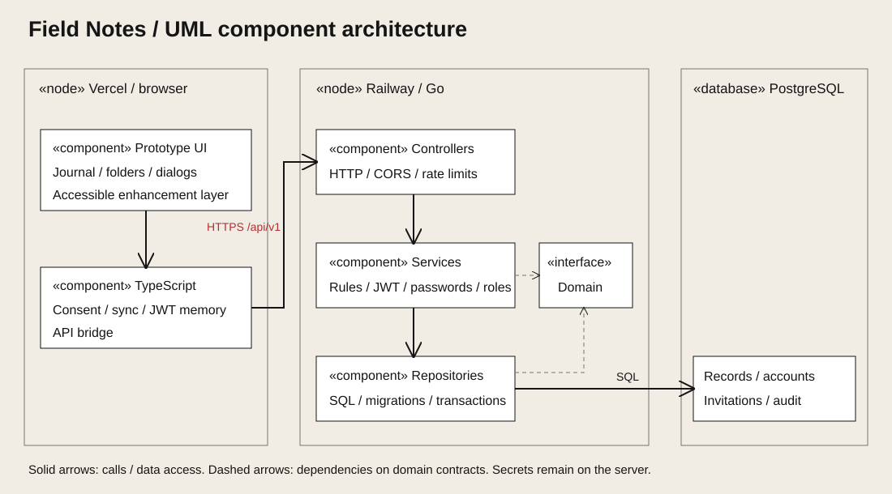
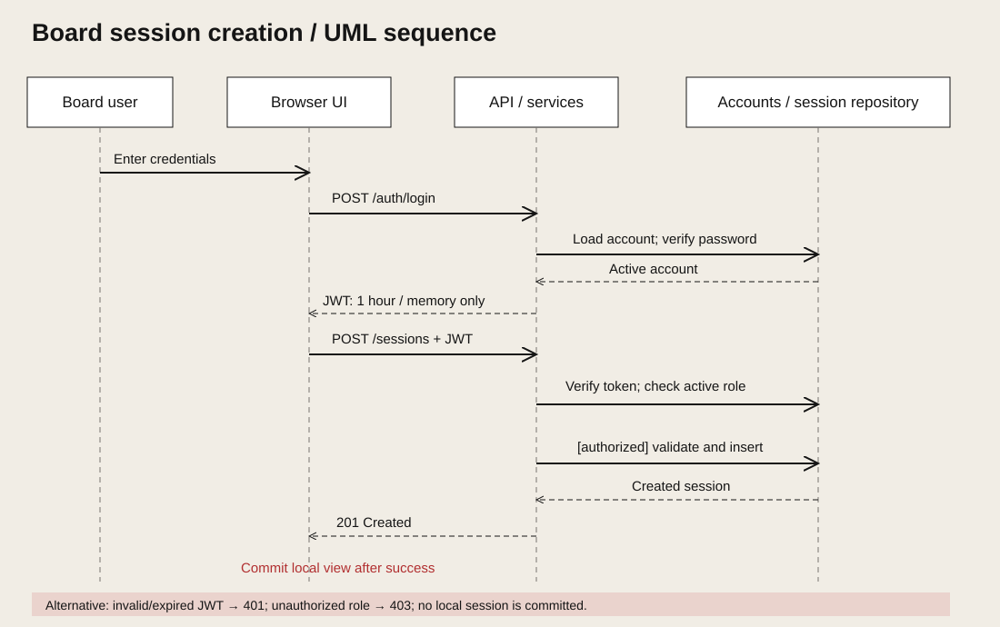

# Field Notes — AIA Brooklyn Urbanism

Field Notes is a public journal and living archive of Brooklyn's walks, assemblies,
and neighborhood conversations. Neighbors record observations and revisit a shared
record that informs community-driven placemaking. The folder/notebook interface uses
Signal Red `#B12F30`, Ink `#151515`, Paper `#F1EDE5`, and Concrete `#77736F`.
Concrete is decorative; darker text supports readability.

Production: https://aiabrooklynurbanism.com

## Architecture



Vite/TypeScript and Go are separate deployables communicating through `/api/v1`.
HTTP controllers handle transport, services enforce business rules, repositories own
SQL, and domain interfaces connect the layers. PostgreSQL migrations run at startup.



## Frontend

- `prototype/index.html` is the canonical UI. Readable changes live in
  `prototype/enhancements.css` and `enhancements.js`.
- Run `node frontend/scripts/sync-prototype.mjs` to update the prototype and
  regenerate `frontend/public/legacy/app.css` and `app.js`. Never edit those outputs directly.
- `frontend/src/main.ts` connects the UI to the API and displays initial loading/failure feedback.
- `privacy.ts` gates optional persistence before the UI starts. Without consent,
  notes, bookmarks and anonymous identifiers stay in memory for the current visit.
  Saving media requires local-storage consent.
- `auth.ts` holds JWTs in memory and clears them on sign-out or authentication failure.
  Refreshing the page requires sign-in again.
- The mobile disclosure menu supports labeled controls, Escape, and closing after
  navigation. Dialogs contain focus and restore it. Reduced-motion preferences suppress
  animations; images show loading and failure states.
- Static media belongs in `frontend/public/media/`. Existing embedded fonts and
  illustrations make the legacy bundle large; skeleton feedback does not reduce bytes.

## Backend and authorization

Go 1.27+, chi, pgx and PostgreSQL run on Railway. Public reading and contributions
remain open. Session creation requires active board or super-admin credentials.

| Role | Read / contribute | Create session | Invite / revoke board |
| --- | --- | --- | --- |
| Visitor | Yes | No | No |
| Board member | Yes | Yes | No |
| Super admin | Yes | Yes | Yes |

**Afreen Anjum Khan, akhannyc72@gmail.com**, is the designated super admin. Email
alone grants no access: a private deployment setup token activates the account once.
Board invitations expire after 24 hours, are one-use, and are stored as SHA-256 hashes.
The admin shares codes privately; the app does not send email. Invitation possession
establishes admission, not independent email verification.

Passwords use PBKDF2-HMAC-SHA256, 600,000 iterations and random 16-byte salts. JWTs use
HS256 with a private server secret, a fixed issuer/algorithm, one-hour expiry, and a
password-version binding. Every protected request reloads the account, so revocation
blocks access immediately. Re-activation invalidates prior tokens. Authentication errors
are generic. Login/activation have a bounded in-process limiter; configure edge rate
limiting before multi-instance deployment. Forwarded IP headers are not blindly trusted.

Migration `0002_accounts.sql` adds accounts and an append-only account-action audit.
Only the super admin can list account emails. Public feedback remains append-only;
administrator status does not silently erase community contributions.

| Route (under `/api/v1`) | Purpose |
| --- | --- |
| `GET /auth/status` | Whether authentication is configured |
| `POST /auth/activate` | Email, invitation/setup token, new password |
| `POST /auth/login` | Email/password → JWT |
| `GET /auth/me` | Current active account |
| `GET /admin/members` | Super-admin account list |
| `POST /admin/members` | Create invitation; return code once |
| `DELETE /admin/members/{email}` | Revoke board access |

Logout clears the browser token. A copied token remains valid until expiry or account
revocation; there are no refresh tokens. Password reset/email delivery are not implemented.
Google sign-in is high priority in [backlog.md](backlog.md), as requested by the owner.

## Setup and deployment

1. Start PostgreSQL (`docker compose up -d db`). Copy `backend/.env.example` to
   `backend/.env` and load it into your shell; the Go server does not auto-load env files.
2. Configure `DATABASE_URL`, `ALLOWED_ORIGINS` and two independent, cryptographically
   random private values of at least 32 characters: `AUTH_JWT_SECRET` and
   `AUTH_BOOTSTRAP_TOKEN`. Generate them in a trusted secret manager; never commit them.
3. Run `go run ./cmd/server` in `backend/`.
4. Copy `frontend/.env.example` to `frontend/.env`, set `VITE_API_URL`, and run
   `npm ci` then `npm run dev` in `frontend/` with Node 24.
5. Open **Board sign-in / administration → Activate**, use the designated admin email,
   private setup token, and your chosen password. Remove `AUTH_BOOTSTRAP_TOKEN` from
   the deployment after activation; the database prevents reuse.
6. Sign in as super admin to admit board members. Share their code privately; they
   activate using the invited email and a password.

Production: Railway serves `backend/`; Vercel builds `frontend/`. Put auth secrets on
Railway and `VITE_API_URL` on Vercel. Require HTTPS and allow only intended frontend
origins. Without a JWT secret, public reading works and board creation fails closed.
Back up PostgreSQL before schema deployment. No real secrets or production accounts
are created by these source changes.

Super-admin recovery requires a trusted database operator; the setup token cannot
overwrite an existing account. Establish that recovery procedure before production use.

## Engineering decisions and challenges solved

1. **Prototype fidelity and maintainability:** readable enhancements plus deterministic
   extraction preserve the established journal, with exact parity checks. The original
   UI is compiled React; a future migration should replace compiled-text integration
   points with normal source components.
2. **Optimistic state and authorization:** session creation waits for authenticated
   server success before local commit. The sync adapter cannot create sessions merely
   because localStorage changed. Public contributions retain their existing offline behavior.
3. **Separate origins:** bearer headers avoid dependence on third-party cookies between
   Vercel and Railway. CORS permits authorization; server role checks are authoritative.
4. **Meaningful consent:** optional persistence defaults off, memory storage keeps the
   journal usable, and withdrawing consent removes saved keys and requests media deletion.
   Shared contributions are separate and explained explicitly.
5. **Accessible editorial design:** larger reading text, visible focus, reduced motion,
   labeled navigation and contrast improvements retain folders, paper and journal typography.
6. **Least privilege:** single-use bootstrap, expiring invitations, account checks on
   every request, and no default password or client-side email-based admin bypass.

## Privacy, accessibility and legal review

The privacy panel explains actual storage categories, offers rejection and later changes,
and introduces no analytics or advertising. Withdrawing storage permission does not delete
published contributions. Multiple open tabs can delay IndexedDB removal until closed.
Hosting logs, retention, incident response and vendor agreements need committee review.

The implementation targets WCAG 2.2 AA practices; it is **not a legal certification**.
A cookie popup alone cannot establish compliance with all US laws. Applicability depends
on the entity, processing, users and state thresholds. AIA Brooklyn must approve the
notice, retention and accessibility policy. No internal AIA Brooklyn policy was supplied.

Guidance: [DOJ accessibility](https://www.ada.gov/resources/web-guidance/),
[W3C WCAG](https://www.w3.org/WAI/standards-guidelines/wcag/),
[FTC cookie information](https://www.ftc.gov/site-information/privacy-policy/internet-cookies),
[California privacy guidance](https://privacy.ca.gov/tips/limit-website-tracking/).
These inform engineering; they do not determine which laws apply to this organization.

## Verification and workflow

Work on `main` unless the owner requests a branch. Read `CLAUDE.md`, `AGENTS.md`,
the constitution and `handoff.md`; append checkpoints whenever work changes.

```text
cd backend
go build ./...
go vet ./...
go test ./...
cd ../frontend
npm run build
node scripts/privacy.test.mjs
```

Build includes TypeScript and prototype parity. Security tests cover JWT tampering,
expiry, inactive accounts, role restrictions and bootstrap reuse. See
[verification notes](docs/verification.md) for browser coverage and deployment limits.
