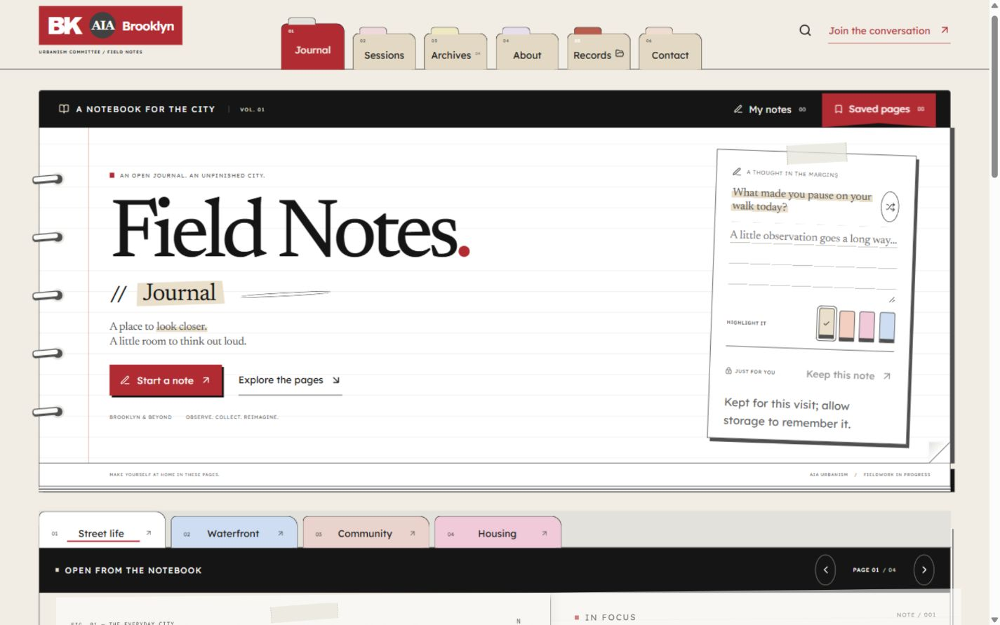
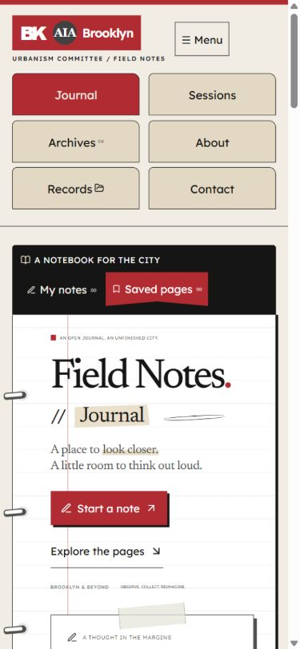

# Verification — feature 002

## Completed on 2026-11-17

- Frontend TypeScript, Vite production build, and exact prototype CSS/JS/metadata parity.
- Backend build, vet, and tests. New tests exercise signed-token acceptance,
  tampering, expiry, inactive-account rejection, role boundaries, bootstrap token
  mismatch/reuse, weak-password rejection, and anonymous session-creation denial.
- Consent behavior test: default-off memory writes, persistence after opt-in,
  optional-key removal and media deletion request after withdrawal.
- Browser review at desktop 1440px, mobile 390px, and narrow 320px widths.
  Reviewed journal, sessions, archives and contact. Corrected notebook toolbar,
  page-tab, and menu overflow; verified 320px and 390px journal width equals the document's
  available client width with the menu open.
- Verified hamburger expanded/collapsed accessibility state, Escape dismissal,
  focus on the first navigation link, route changes, and board-access dialog on
  Create a session. Escape returns focus to the Create a session button.
- Reopened storage choices and selected Necessary only. Reviewed mobile banner
  layout and desktop/mobile screenshots. Journal DOM inspection found no buttons
  without accessible names and no image elements missing alt attributes.
- SVG UML files validated as XML. Diagrams describe components and the protected
  session-creation sequence.

## Limits and required deployment checks

- No PostgreSQL server or Docker was available locally. The new migration and
  real-database activation/invitation lifecycle still need a staging integration run.
- No production auth secrets were configured and no real account was activated.
  Set AUTH_JWT_SECRET and AUTH_BOOTSTRAP_TOKEN privately on Railway, deploy the
  migration, activate the designated admin, then remove the bootstrap token.
- This was browser/keyboard/accessibility-tree review, not a complete screen-reader
  audit, physical-device matrix, WCAG certification, or legal review.
- Image loading/error handlers were implemented; embedded images load quickly locally.
  A throttled-network media run and all media types still need staging verification.
- Existing npm audit reported four high-severity findings; dependency remediation is
  tracked separately. Google sign-in and account recovery improvements are backlog.
- AIA Brooklyn must approve the privacy notice and retention/recovery procedures.

